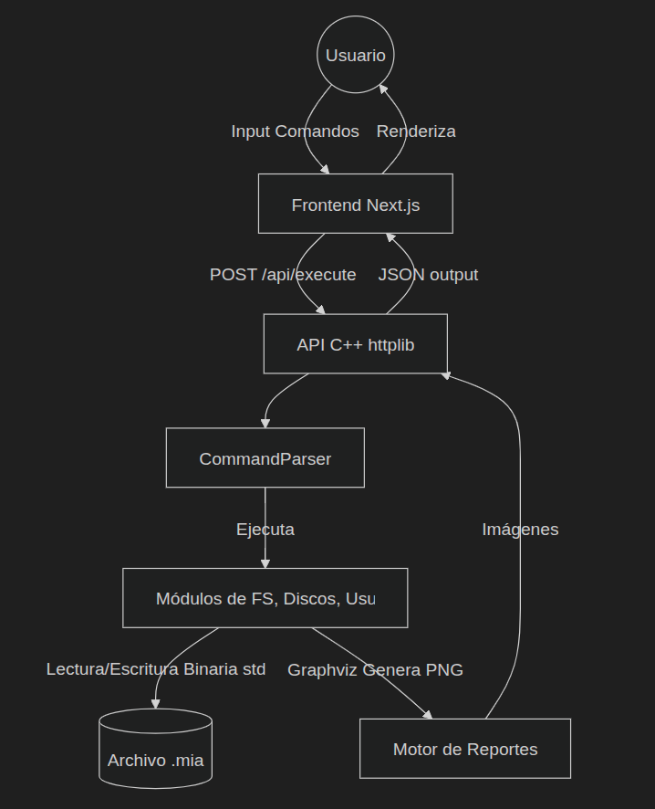

<div align="center">


## UNIVERSIDAD DE SAN CARLOS DE GUATEMALA

### FACULTAD DE INGENIERÍA

### MANEJO E IMPLEMENTACIÓN DE ARCHIVOS

<br><br>

# MANUAL TÉCNICO - ExtreamFS

<br><br>

**Catedrático:** Ing. William Estuardo Escobar Argueta

**Auxiliar:** Daniel Eduardo Mellado Ayala

**Nombre:** Pablo Daniel Velásquez Hernández

**Carnet:** 202302232

**Sección:** B

**Semestre:** Primer Semestre 2026

<br><br>

</div>

---

# Manual Técnico - ExtreamFS (Simulador de Sistema de Archivos EXT2)

Este manual técnico proporciona una visión documentada y estructurada del funcionamiento interno del simulador de sistema de archivos EXT2, detallando su arquitectura, el manejo de estructuras de datos fundamentales y los comandos implementados para la interacción con el sistema.

---

## 1. Requerimientos Mínimos del Sistema

Para el correcto funcionamiento y despliegue del proyecto **ExtreamFS**, el sistema anfitrión debe cumplir con los siguientes requisitos:

### 1.1. Sistema Operativo

- **Linux:** Se recomienda cualquier distribución basada en Debian (como Ubuntu 22.04 LTS o superior) debido a la compatibilidad nativa con las llamadas de sistema para manejo de archivos binarios y compiladores C++.

### 1.2. Backend (Servidor C++)

- **Compilador:** `g++` con soporte para el estándar **ISO C++17** o superior.
- **Librerías:**
  - `cpp-httplib`: Para la gestión del servidor HTTP (incluida en el proyecto).
  - `nlohmann/json`: Para el manejo de datos JSON (incluida en el proyecto).
- **Herramientas Externas:**
  - **Graphviz:** Es indispensable tener instalado `dot` en el PATH del sistema para la generación de reportes visuales (`.png`, `.jpg`).

### 1.3. Frontend (Cliente Next.js)

- **Node.js:** Versión 18.0.0 o superior.
- **Gestor de Paquetes:** `npm`, `yarn` o `pnpm` para la instalación de dependencias y ejecución del servidor de desarrollo.
- **Navegador Web:** Un navegador moderno (Chrome, Firefox, Edge) con soporte para JavaScript ES6+.

---

## 2. Descripción de la Arquitectura del Sistema

El proyecto está diseñado bajo una arquitectura Cliente-Servidor separando claramente la interfaz de usuario (Frontend) y la lógica de negocio y procesamiento de datos (Backend).

### 2.1. Arquitectura Frontend (Cliente)

Desarrollado con **Next.js** y **React**, el frontend proporciona una aplicación web interactiva (Single Page Application - SPA) que permite a los usuarios introducir scripts de comandos y visualizar los resultados devueltos por el sistema subyacente.

**Fragmento Clave (Frontend - Llamada a la API):**
En [`page.tsx`](../Frontend/app/page.tsx), la función `handleExecute` en [`command-editor.tsx`](../Frontend/components/command-editor.tsx) se encarga de enviar los comandos al servidor:

```typescript
const response = await executeCommand(trimmedLine);
if (response.success) {
  const raw = response.output || "Comando ejecutado exitosamente";
  // Mostrar líneas en consola
  handleMountResponse(trimmedLine, response.output);
  handleReportResponse(trimmedLine, response.output);
}
```

- **Componentes Principales (React):**
  - **`CommandEditor` ([`command-editor.tsx`](../Frontend/components/command-editor.tsx)):** Un componente interactivo basado en TextArea que permite la escritura manual de los comandos o la carga de archivos `.mia` a través de un botón especializado (utilizando `FileReader` de HTML5). Destaca un renderizado superpuesto que pinta los comentarios de color verde usando clases condicionales de Tailwind CSS.
  - **`OutputConsole` ([`output-console.tsx`](../Frontend/components/output-console.tsx)):** Consola emuladora. Recibe un listado de objetos que dictaminan si un texto es tipo "command", "success", "error" o "info" e inyecta íconos (`CheckCircle2`, `XCircle`, `Terminal`) junto al texto formateado de respuesta. Incluye funcionalidad de auto-scroll hacia abajo cada que se inyecta nueva información.
  - **Componentes Visualizadores ([`mounted-partitions.tsx`](../Frontend/components/mounted-partitions.tsx) y [`report-viewer.tsx`](../Frontend/components/report-viewer.tsx)):** Se encargan de encapsular el renderizado de tarjetas interactivas cada que el frontend parsea y descubre que ha habido un `mount` exitoso o se ha generado un `rep` respectivamente. Usan `Tabs` de Radix UI para organizar visualmente las vistas.
- **Comunicación:** Se comunica con el backend mediante peticiones HTTP `POST` hacia la ruta `/api/execute`, enviando los comandos de texto plano, y consume imágenes estáticas u otros recursos a través de `GET /api/reports/:path`.

### 2.2. Arquitectura Backend (Servidor)

Escrito en **C++** puro, el backend se encarga de emular por completo el acceso a bajo nivel a archivos binarios simulando discos físicos, gestionando sus particiones y formateando los mismos bajo el formato EXT2.

**Fragmento Clave (Backend - Servidor y Endpoint POST):**
En [`main.cpp`](../Backend/main.cpp), se usa `httplib` para capturar la petición, procesar el texto y devolver output:

```cpp
server.Post("/api/execute", [&setCORS](const httplib::Request& req, httplib::Response& res) {
    setCORS(res);
    auto body = json::parse(req.body);
    std::string command = body["command"];

    // El núcleo de control:
    std::string output = processLine(command);

    json response = { {"success", !isError}, {"output",  output} };
    res.set_content(response.dump(), "application/json");
});
```

- **Servidor HTTP (`httplib`):** Se utiliza la librería [`httplib.h`](../Backend/httplib.h) en [`main.cpp`](../Backend/main.cpp) para exponer la API REST, exponiendo principalmente los endpoints `/api/execute` (para inyección de comandos) y `/api/reports` (para servir las imágenes generadas).
- **Módulos Principales:**
  - `CommandParser`: Analizador léxico rudimentario que toma la cadena de texto de entrada, la divide y agrupa parámetros (ej. `-size=10`), y luego direcciona el flujo lógico al submódulo correspondiente según el comando detectado (`cmdMkdisk`, `cmdFdisk`, `cmdMkfs` en [`Mkfs.cpp`](../Backend/FileSystem/Mkfs.cpp), etc.).
  - `Estructuras (Structs.h)`: Definición byte a byte de todas las piezas manejadas binariamente (MBR, Inodos, SuperBloques).
  - `DiskManagement` / `FileSystem`: Ejecutan lecturas/escrituras binarias directas a los archivos físicos de extensión `.mia`. Dependen fuertemente de buscar desplazamientos por bytes en los archivos simuladores de bloque computacional.

**Diagrama de Integración Conceptual:**



---

## 3. Explicación de las Estructuras de Datos

El pilar funcional de esta aplicación es el empaquetado exacto de los bytes y bytes offsets (`#pragma pack(push, 1)`) en C++.

### 3.1. Estructuras a nivel de Disco

- **MBR (Master Boot Record):** Es el registro principal, ubicado al inicio exacto de un disco virtual (byte 0).
  - Almacena información global: tamaño total del disco (`MbrSize`), firma única, fecha de creación (`CreationDate`) y el tipo de ajuste (`Fit`).
  - Consta de un arreglo rígido de 4 compartimentos `Partition`. Al menos un `Status = 0` indica que tal espacio está disponible. Solo una partición en todo el MBR puede y debe ser del tipo `Extendida` (`Type = 'E'`).

**Fragmento Clave (Estructuras de Particionamiento [`Structs.h`](../Backend/Estructuras/Structs.h)):**

```cpp
struct MBR {
    int       MbrSize;          // Tamaño total del disco
    time_t    CreationDate;     // Fecha de creación
    int       Signature;        // Número aleatorio único
    char      Fit;              // B, F, W
    Partition Partitions[4];    // Las 4 particiones
};
```

- **EBR (Extended Boot Record):** Se emplean exclusivamente para crear Particiones Lógicas dentro de una Partición Extendida.
  - Funcionan como una lista enlazada a través del puntero `Next`, que indica el byte exacto donde inicia el siguiente EBR dentro de la franja total de la partición extendida principal correspondiente. Contienen el inicio (`Start`) y tamaño (`Size`) de la partición lógica que gestionan.

### 3.2. Estructuras a nivel de Sistema de Archivos (EXT2)

Toda partición una vez parseada (comando `mkfs`) recibe su formato virtual interno.

- **SuperBloque (`SuperBloque`):** El administrador de la partición formateada. Se halla al inicio de cada partición formateada. Mantiene cuentas globales como `InodesCount`, `BlocksCount`, cuenta lo que queda libre (`FreeBlocksCount`), y enlista la posición por byte donde inician cada una de las demás estructuras dentro del archivo maestro `.mia` (ej. `BmInodeStart`, `InodeStart`).

**Fragmento Clave (Inodo en [`Structs.h`](../Backend/Estructuras/Structs.h)):**

```cpp
struct Inode {
    int    Uid;              // UID del propietario
    int    Gid;              // GID del grupo
    int    Size;             // Tamaño en bytes
    time_t Atime;            // Último acceso
    time_t Ctime;            // Creación
    time_t Mtime;            // Última modificación
    int    Block[15];        // 12 directos + 3 indirectos
    char   Type;             // 1 = archivo, 0 = carpeta
    char   Perm[3];          // Permisos UGO
};
```

- **Inodo (`Inode`):** Representación teórica de un archivo o directorio. Todo elemento creado se acopla a un Inodo.
  - Registra a quién le pertenece (`Uid`, `Gid`), su tamaño en datos reales (`Size`), y fechas (`Atime`, `Ctime`, `Mtime`).
  - _Bloques:_ Contiene un array int `Block[15]`. Del espacio 0 al 11 son referencias directas a `FileBlock` o `FolderBlock`. Si se supera este límite de referencias, pasa al esquema indirecto de acceso.

- **Bloques de Archivo y Carpeta (`FileBlock` / `FolderBlock` / `PointerBlock`):**
  - **Bloque de Carpeta (`FolderBlock`):** Contiene 4 arreglos con un nombre fijo (12 char) y el `Inodo` apuntado (`int`). Esto da vida a la jerarquía, relacionando nombres hijos con inodos hijos dentro del FileSystem.
  - **Bloque de Archivo (`FileBlock`):** Una hoja que simplemente encapsula 64 bytes llanos de información en formato cadena de texto pura (`char content[64]`).
  - **Bloque de Apuntadores (`PointerBlock`):** Se usa como nodo intermedio cuando los 12 bloques directos de un inodo se agotan, su labor no es almacenar contenido o nombres jerárquicos, sino simplemente portar hasta un máximo de 16 apuntadores (`int`) hacia otros bloques para aumentar la capacidad infinita simulada de un inodo único.

---

## 4. Descripción de los Comandos Implementados

La comunicación funcional es script-based. Todos estos comandos soportados funcionan con formato de banderas o sintaxis `<comando> [-flag=valor]*`.

### Comandos de Administración de Discos

**Fragmento Clave (Parseo de comandos en [`CommandParser.cpp`](../Backend/CommandParser/CommandParser.cpp)):**

```cpp
if      (command == "mkdisk")  return cmdMkdisk(params);
else if (command == "rmdisk")  return cmdRmdisk(params);
else if (command == "fdisk")   return cmdFdisk(params);
else if (command == "mount")   return cmdMount(params);
else if (command == "mkfs")    return cmdMkfs(params);
```

- **MKDISK:** Crea un archivo físico que emula a un disco duro, pre-llenándolo de carácteres '0' binarios.
  - _Parámetros:_ `-size` (obligatorio, entero numérico), `-path` (obligatorio, ruta del host), `-unit` (opcional: K o M), `-fit` (opcional: BF, FF, WF).
  - _Sintaxis:_ `mkdisk -size=5 -unit=M -path=/tmp/disco.mia`

- **RMDISK:** Desaparece el archivo físico y destruye la emulación del disco creado.
  - _Parámetros:_ `-path` (ruta exacta simulada o real de creación del disco a borrar).

- **FDISK:** Realiza particionamiento bajo el formato MBR. Gestiona internamente el binario inyectando/pisando las estructuras `Partition` o `EBR` correspondientes al hueco libre si el ajuste dictado (`-fit`) lo permite.
  - _Parámetros:_ `-size`, `-path`, `-name` (todos obligatorios), `-unit`, `-type` (P = Primaria, E = Extendida, L = Lógica), `-fit`, `-delete` (Fast o Full), `-add` (añade tamaño).

- **MOUNT / MOUNTED:**
  - _MOUNT:_ Registra temporalmente en la RAM del backend la apertura continua de una partición dictada. Se asigna un identificador especial a su sesión (`-id`), activando a dicha partición para futuros algoritmos de gestión EXT2.
  - _MOUNTED:_ Bandera abstracta que ordena listado activo de todo lo que esté subido en RAM por `mount`.

### Comandos de Administración de Sistema de Archivos

- **MKFS:** Realiza el _"formateo"_ físico (llenar la data con '0', e inicializar bit a bit un `SuperBloque`, sus Inodos base iniciales y su raíz - Inodo 0 y `/users.txt`).
  - _Parámetros:_ `-id` (el que fue dado por MOUNT para saber la metadata, obligatorio), `-type` (2fs/full - único permitido).
  - _Mecánica Interna ([`Mkfs.cpp`](../Backend/FileSystem/Mkfs.cpp)):_ Calcula geométricamente la partición. Con el puntero recuperado de `mount`, invoca la siguiente fórmula para deducir `$n$` (La máxima cantidad de inodos posibles):
    ```cpp
    long n = (long)floor( (partSize - sizeof(SuperBloque)) / (4 + sizeof(Inode) + 3*64) );
    ```
    Posteriormente, establece todo el _Bitmap de inodos_ y el _Bitmap de bloques_ llenos de caractéres `'0'`. Crea las inicializaciones correspondientes para la primera carpeta `root/` asignándole el Inodo 0 y ubicando el Inodo 1 para inyectar un FileBlock quemado con la información inicial de usuarios `1,G,root\n1,U,root,root,123\n`.

- **LOGIN / LOGOUT:** Inicia sesión frente a un ID montado, comparando `user` y `pwd` frente al archivo jerárquico fijo oculto localmente en `/users.txt` dentro de la partición EXT2 subida recientemente y que debe poseer un sistema de archivos compatible.

### Comandos de Administración de Archivos/Software

- **MKDIR:** A partir del usuario validado en sesión, invoca a la recursividad si lleva `-p`. Busca inodos libres, actualiza tamaños y si falta espacio anida un nuevo `FolderBlock`.
  - _Parámetros:_ `-path` (ruta a construir dentro de root de `/`), `-p` (bandera flag para creación jerárquica padre dependiente).

- **MKFILE:** Parecido a MkDir pero inyectando `FileBlock` rellenado según atributos y asignando un string text.
  - _Parámetros:_ `-path`, `-r` (crear parientes padres si faltan), `-size` (crea un string base en el bloque de archivo), `-cont` (referencia o asimila el archivo del host anfitrión si lo logra leer para inyectarlo al FileBlock de la simulación).

- **CAT:** Algoritmo que rastrea bloque a bloque por medio de Inodos en búsqueda de un match de la ruta y parsea los bytes de vuelta transformándolo en texto puro en el dashboard Frontend.
  - _Parámetros:_ `-file1`, `-fileN` (permite leer multiples paths simulados secuencialmente).

### Comandos de Permisos y Usuarios Local (Requieren super usuario "root")

- **MKGRP / RMGRP:** Mutan agregando en las últimas líneas del FileBlock de inodo correspondiente a `/users.txt`, un formato de datos para crear o inhabilitar (colocar contador 0) a grupos y usuarios.
- **MKUSR / RMUSR:** Crea usuarios que obligatoriamente deben atarse a subgrupos preexistentes.
- **CHGRP:** Invade parámetros en strings pre-iniciados de un usuario fijo alterando su cadena ligada para simular el cambio de credenciales de grupo.

### Comandos de Sistemas Repositorio

- **REP:** Sistema de GraphViz emulador visual por medio del command parser. Lee el archivo, detecta su metadata e imprime scripts de grafos para la visualización abstracta.
  - _Parámetros:_ `-name` (mbr, disk, inode, block, tree, sb, file, ls, etc.), `-path` (directorio host donde generará las imágenes), `-id` o `-ruta`.
