<div align="center">


## UNIVERSIDAD DE SAN CARLOS DE GUATEMALA

### FACULTAD DE INGENIERÍA

### MANEJO E IMPLEMENTACIÓN DE ARCHIVOS

<br><br>

# MANUAL DE USUARIO - ExtreamFS

<br><br>

**Catedrático:** Ing. William Estuardo Escobar Argueta

**Auxiliar:** Daniel Eduardo Mellado Ayala

**Nombre:** Pablo Daniel Velásquez Hernández

**Carnet:** 202302232

**Sección:** B

**Semestre:** Primer Semestre 2026

<br><br>

</div>

---

### 1. Introducción

ExtreamFS es una aplicación web moderna que simula un sistema de archivos completo basado en **EXT2**. Permite crear discos virtuales (.mia), particiones, formatear el sistema de archivos, gestionar usuarios y grupos, crear/eliminar archivos y carpetas, y generar reportes gráficos profesionales con Graphviz.

Todo se ejecuta de forma local en tu computadora sin necesidad de hardware físico ni conexión a internet. La interfaz es intuitiva y permite ejecutar comandos manualmente o mediante scripts (.mia).

**Objetivo del manual:** Guiarte paso a paso para que puedas utilizar todas las funcionalidades de forma eficiente y sin errores.

---

### 2. Requisitos del Sistema

- **Sistema Operativo:** Windows 10/11, Linux (cualquier distribución) o macOS.
- **Navegador:** Chrome, Edge o Firefox (versión actualizada).
- **Memoria RAM:** Mínimo 4 GB (recomendado 8 GB para discos grandes).
- **Espacio en disco:** Suficiente para los archivos .mia que crees (ej. 1 GB = 1 GB en tu disco).
- **Software adicional:** Ninguno (todo incluido en la aplicación).

**Nota:** El backend está desarrollado en C++.

---

### 3. Cómo Iniciar la Aplicación

1. Abre la carpeta del proyecto.
2. Ejecuta el backend (en la terminal colocar ./build.sh).
3. Abre el frontend en tu navegador (Ejecutando el comando npm run dev y normalmente http://localhost:3000 o la URL indicada).

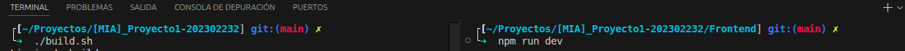

4. La pantalla de bienvenida aparecerá inmediatamente.

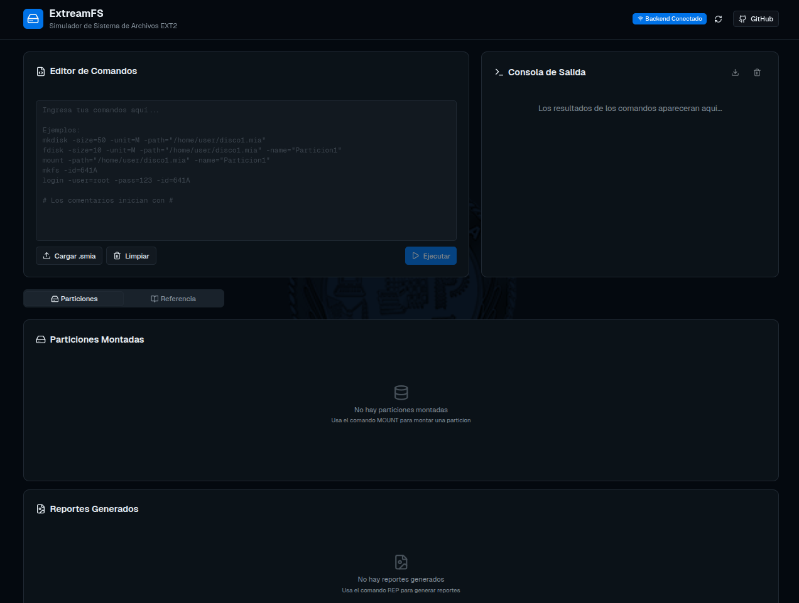

---

### 4. Descripción de la Interfaz Principal

La interfaz está dividida en secciones claras y modernas:

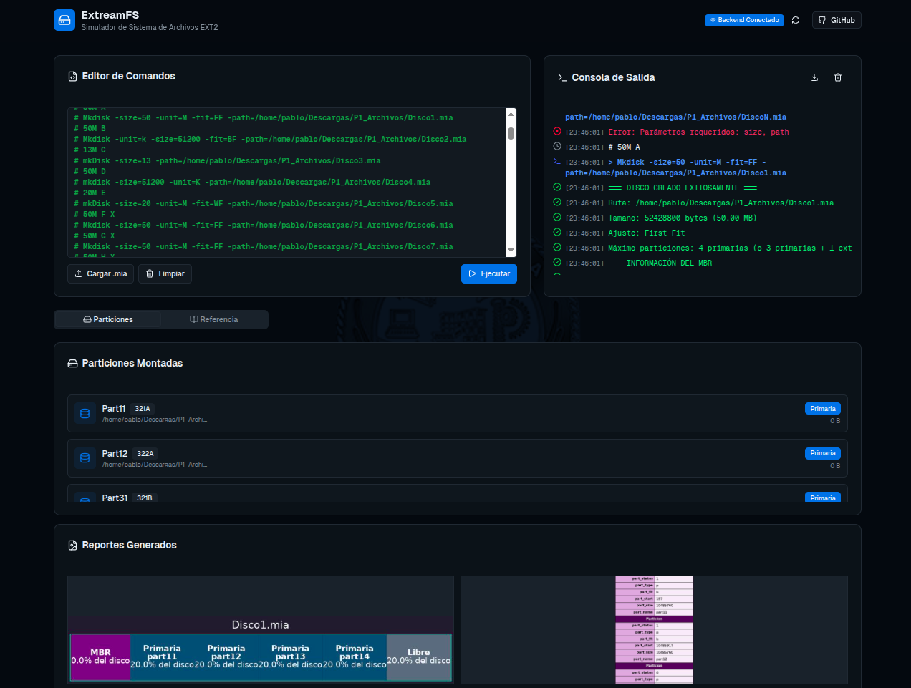

#### 4.1 Editor de Comandos

- Área de texto grande donde escribes comandos o pegas scripts.
- Soporta comentarios con `#`.
- **Ejecución Segura:** Al ejecutar, los comandos procesados se convierten automáticamente en comentarios (texto verde precedido por `#`) para evitar re-ejecuciones accidentales.
- Botones:
  - **Cargar .mia**: Selecciona un archivo de script.
  - **Limpiar**: Borra todo el contenido.
  - **Ejecutar** (azul): Procesa todos los comandos y muestra resultados.

  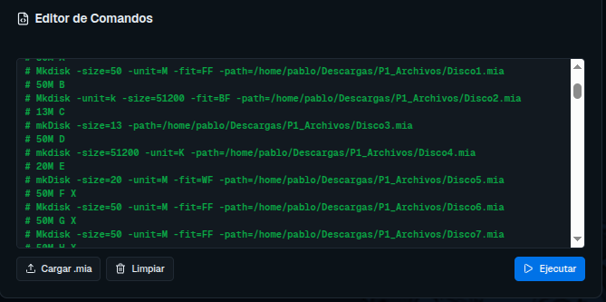

#### 4.2 Consola de Salida

- Muestra mensajes, errores y resultados de cada comando en tiempo real con **auto-scroll** automático.
- Utiliza íconos visuales para identificar rápidamente el tipo de evento:
  - ✅ **Check Verde:** Ejecución exitosa.
  - ❌ **Roja:** Error en la ejecución.
  - 💻 **Terminal Azul:** Comando ingresado.
  - 🕒 **Reloj Gris:** Mensajes de información general.
- Puedes descargar el contenido o limpiarlo.

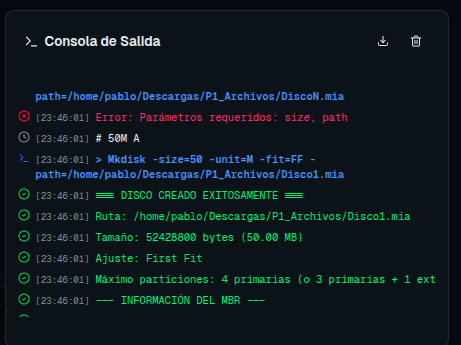

#### 4.3 Particiones Montadas

- Lista todas las particiones activas con su ID (ej. 341A).
- Muestra mensaje “No hay particiones montadas” al inicio.

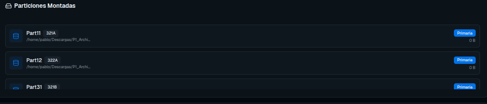

#### 4.4 Reportes Generados

- Lista los reportes que hayas creado con el comando `rep`.
- Permite visualizarlos o descargarlos.

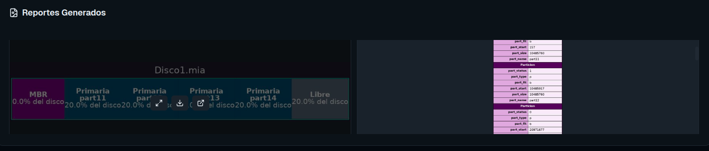

#### 4.5 Pestañas inferiores

- **Particiones**: Acceso rápido a particiones montadas.

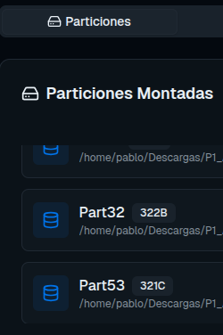

- **Referencia**: Lista rápida de comandos (recomendado usarla siempre).

## 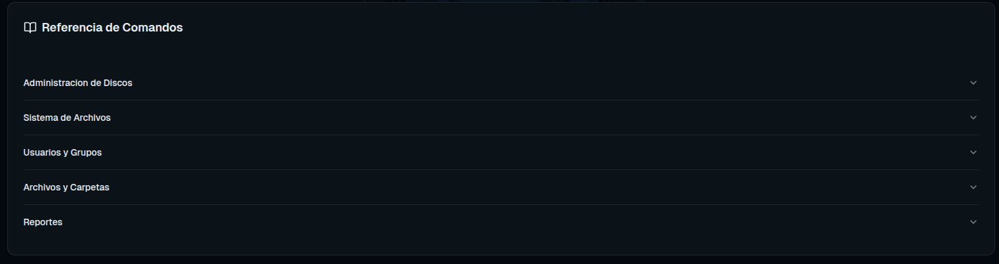

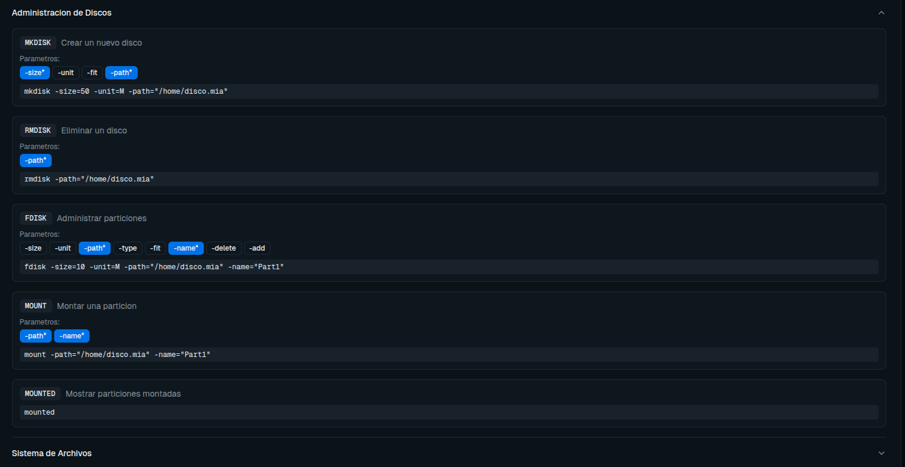

#### 4.6 Estado de Conexión

- Ubicado en la barra superior derecha, este indicador visual (Punto verde o gris) muestra en tiempo real si el Frontend está conectado exitosamente al servidor C++ (Backend).


#### 4.7 Botón a GitHub

- Ubicado en la barra superior derecha, este botón nos redirige automaticamente al repositorio de este proyecto en GitHub


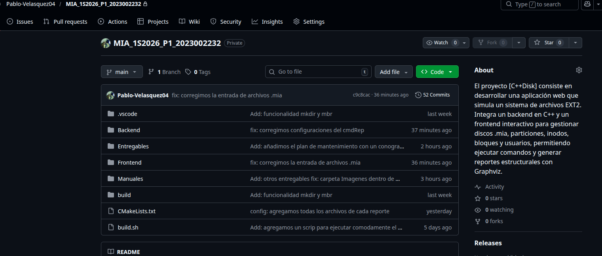

---

### 5. Uso Básico

1. Escribe comandos en el **Editor de Comandos** (uno por línea o varios).
2. Presiona **Ejecutar**.
3. Observa los resultados en la **Consola de Salida**.
4. Monta particiones con `mount` para usar comandos de archivos.
5. Inicia sesión con `login` (usuario root por defecto).

**Consejo:** Usa scripts .mia para pruebas largas. Crea uno con Notepad y cárgalo.

---

### 6. Comandos Disponibles (Detallados)

Los comandos no distinguen mayúsculas/minúsculas. Parámetros en cualquier orden. Usa comillas dobles para rutas con espacios.

#### 6.1 Tabla Resumen de Comandos

| Comando        | Descripción                                                       | Ejemplo de Uso                                              |
| :------------- | :---------------------------------------------------------------- | :---------------------------------------------------------- |
| **mkdisk**     | Crea un nuevo disco virtual (.mia).                               | `mkdisk -size=50 -unit=M -path=/home/disco1.mia`            |
| **rmdisk**     | Elimina un disco virtual existente.                               | `rmdisk -path=/home/disco1.mia`                             |
| **fdisk**      | Gestiona (crea, borra, modifica) particiones (MBR).               | `fdisk -size=10 -unit=M -path=/home/disco1.mia -name=Part1` |
| **mount**      | Monta una partición en la memoria RAM.                            | `mount -path=/home/disco1.mia -name=Part1`                  |
| **mounted**    | Lista todas las particiones actualmente montadas.                 | `mounted`                                                   |
| **mkfs**       | Formatea una partición montada con el sistema de archivos (EXT2). | `mkfs -id=341A`                                             |
| **login**      | Inicia sesión de usuario en una partición montada.                | `login -user=root -pass=123 -id=341A`                       |
| **logout**     | Cierra la sesión del usuario actual.                              | `logout`                                                    |
| **mkgrp**      | Crea un nuevo grupo de usuarios (Requiere root).                  | `mkgrp -name=estudiantes`                                   |
| **rmgrp**      | Elimina un grupo de usuarios (Requiere root).                     | `rmgrp -name=estudiantes`                                   |
| **mkusr**      | Crea un nuevo usuario asignado a un grupo (Requiere root).        | `mkusr -user=pablo -pass=1234 -grp=estudiantes`             |
| **rmusr**      | Elimina un usuario existente (Requiere root).                     | `rmusr -user=pablo`                                         |
| **chgrp**      | Cambia de grupo a un usuario existente (Requiere root).           | `chgrp -user=pablo -grp=invitados`                          |
| **mkfile**     | Crea un archivo de texto dentro del sistema simulado.             | `mkfile -path=/home/user/docs/a.txt -r -size=15`            |
| **mkdir**      | Crea un directorio jerárquico.                                    | `mkdir -path=/home/user/docs/usac -p`                       |
| **cat**        | Muestra en consola el contenido de uno o más archivos.            | `cat -file1=/home/user/docs/a.txt`                          |
| **remove**     | Elimina archivos o carpetas de forma recursiva.                   | `remove -path=/home/archivo.txt`                            |
| **rename**     | Renombra un archivo o carpeta.                                    | `rename -path=/home/viejo.txt -name=nuevo.txt`              |
| **copy**       | Duplica archivos o carpetas recursivamente.                       | `copy -path=/home/original.txt -destino=/home/backup.txt`   |
| **move**       | Traslada archivos o carpetas a otra ubicación.                    | `move -path=/home/archivo.txt -destino=/documentos/`        |
| **find**       | Busca archivos por patrón de nombre (regex).                      | `find -path=/ -name=".*\.txt"`                              |
| **chmod**      | Modifica los permisos de archivos/carpetas (UGO).                 | `chmod -path=/home/archivo.txt -ugo=755`                    |
| **chown**      | Cambia el propietario de un archivo o carpeta.                    | `chown -path=/home/archivo.txt -user=otrouser`              |
| **reset**      | Reinicia el estado global del simulador.                          | `execute`                                                   |
| **journaling** | Muestra el registro de transacciones (EXT3).                      | `journaling -id=341A`                                       |
| **loss**       | Simula corrupción de datos en la partición.                       | `loss -id=341A -percentage=10`                              |
| **rep**        | Genera reportes gráficos del disco y archivos.                    | `rep -id=341A -path=/home/reports/tree.jpg -name=tree`      |

#### 6.2 Administración de Discos

**mkdisk** – Crear disco virtual

```
mkdisk -size=<número> -unit=<K|M> -path=<ruta> [-fit=<BF|FF|WF>]
```

Ejemplo:

```
mkdisk -size=50 -unit=M -path="/home/user/disco1.mia"
```

**rmdisk** – Eliminar disco

```
rmdisk -path=<ruta>
```

**fdisk** – Crear/eliminar/modificar particiones

```
fdisk -size=<número> -unit=<B|K|M> -path=<ruta> -name=<nombre> [-type=<P|E|L>] [-fit=<BF|FF|WF>]
fdisk -delete=<fast|full> -path=<ruta> -name=<nombre>
fdisk -add=<tamaño> -unit=<B|K|M> -path=<ruta> -name=<nombre>
```

- `-delete`: Elimina una partición existente de forma rápida (`fast`) o completa (`full`).
- `-add`: Agrega o quita espacio a una partición existente.

Ejemplos en el editor de la interfaz.

**mount** – Montar partición

```
mount -path=<ruta> -name=<nombre partición>
```

Genera ID automático (ej. 341A).

**mounted** – Listar particiones montadas  
(solo escribe `mounted`)

#### 6.3 Administración del Sistema de Archivos

**mkfs** – Formatear partición con EXT2

```
mkfs -id=<ID> [-type=full]
```

Ejemplo: `mkfs -id=341A`

**cat** – Mostrar contenido de archivos

```
cat -file1=<ruta> [-file2=<ruta>] ...
```

#### 6.4 Administración de Usuarios y Grupos

**login** – Iniciar sesión

```
login -user=<usuario> -pass=<contraseña> -id=<ID>
```

Usuario por defecto: **root** / **123**

**logout** – Cerrar sesión

**mkgrp** – Crear grupo (solo root)

```
mkgrp -name=<nombre>
```

**rmgrp** – Eliminar grupo (solo root)

**mkusr** – Crear usuario (solo root)

```
mkusr -user=<nombre> -pass=<contraseña> -grp=<grupo>
```

**rmusr** – Eliminar usuario (solo root)

**chgrp** – Cambiar grupo de usuario (solo root)

```
chgrp -user=<usuario> -grp=<nuevo_grupo>
```

#### 6.5 Administración de Archivos y Carpetas

**mkfile** – Crear archivo

```
mkfile -path=<ruta> [-size=<número>] [-r] [-cont=<ruta origen>]
```

- `-r`: Crear carpetas padre automáticamente.
- `-cont`: Copiar contenido de un archivo real.

Ejemplo:

```
mkfile -size=15 -path="/home/user/docs/a.txt" -r
```

**mkdir** – Crear carpeta

```
mkdir -path=<ruta> [-p]
```

`-p`: Crear carpetas padre automáticamente.

Ejemplo:

```
mkdir -p -path="/home/user/docs/usac"
```

**remove** – Eliminar archivos o carpetas

```
remove -path=<ruta> [-r]
```

- `-r`: Elimina de forma recursiva carpetas y su contenido.

Ejemplo:

```
remove -path=/home/archivo.txt
remove -path=/home/folder -r
```

**rename** – Renombrar archivos o carpetas

```
rename -path=<ruta_actual> -name=<nuevo_nombre>
```

Ejemplo:

```
rename -path=/home/viejo.txt -name=nuevo.txt
```

**copy** – Copiar archivos o carpetas

```
copy -path=<ruta_origen> -destino=<ruta_destino> [-r]
```

- `-r`: Copia carpetas de forma recursiva con todo su contenido.

Ejemplos:

```
copy -path=/home/original.txt -destino=/home/backup.txt
copy -path=/dir1 -destino=/dir2 -r
```

**move** – Mover o trasladar archivos

```
move -path=<ruta_origen> -destino=<ruta_destino>
```

Ejemplo:

```
move -path=/home/archivo.txt -destino=/documentos/
```

**find** – Buscar archivos por patrón

```
find -path=<ruta_base> -name=<patrón_regex>
```

Busca archivos usando expresiones regulares. Ejemplos:

```
find -path=/ -name=".*\.txt"
find -path=/documentos -name="^archivo.*\.doc"
```

**chmod** – Cambiar permisos

```
chmod -path=<ruta> -ugo=<permisos> [-r]
```

- Permisos se especifican en formato octal UGO (3 dígitos): Usuario, Grupo, Otros.
- `-r`: Aplica recursivamente a carpetas y su contenido.

Ejemplo:

```
chmod -path=/home/archivo.txt -ugo=755
chmod -path=/dir -ugo=644 -r
```

**chown** – Cambiar propietario

```
chown -path=<ruta> -user=<nuevo_usuario> [-r]
```

- Solo root puede cambiar propietarios.
- `-r`: Aplica recursivamente.

Ejemplo:

```
chown -path=/home/archivo.txt -user=otrouser
chown -path=/dir -user=admin -r
```

#### 6.6 Comandos Avanzados del Sistema de Archivos

**reset** – Reiniciar el estado global

```
execute
```

Reinicia completamente el simulador, limpiando todas las monturas y sesiones activas.

Ejemplo:

```
execute
```

**journaling** – Ver registro de transacciones

```
journaling -id=<ID>
```

Muestra el historial de todas las operaciones realizadas en la partición (requiere EXT3).

Ejemplo:

```
journaling -id=341A
```

**loss** – Simular corrupción de datos

```
loss -id=<ID> [-percentage=<número>]
```

Destruye aleatoriamente bloques de datos para simular fallos.

Ejemplo:

```
loss -id=341A -percentage=10
```

#### 6.7 Reportes (Comando REP) – Muy importante para calificación

```
rep -id=<ID> -path=<ruta salida> -name=<tipo> [-ruta=<ruta interna>]
```

- `-ruta`: Bandera **obligatoria** si el tipo de reporte es `file` o `ls`, para indicar el archivo o carpeta objetivo dentro del sistema EXT2.

**Tipos disponibles:**

- `mbr` → Reporte Master Boot Record
- `disk` → Mapa completo del disco
- `inode` → Tabla de inodos
- `block` → Bloques usados
- `bm_inode` → Bitmap de inodos (txt)
- `bm_block` → Bitmap de bloques (txt)
- `tree` → Árbol de directorios (más usado)
- `sb` → Superbloque
- `file` → Contenido de un archivo específico
- `ls` → Listado con permisos

Ejemplo:

```
rep -id=341A -path="/home/reports/reporte_tree.jpg" -name=tree
```

Los reportes se guardan automáticamente en la ruta indicada y aparecen en la sección **Reportes Generados**.

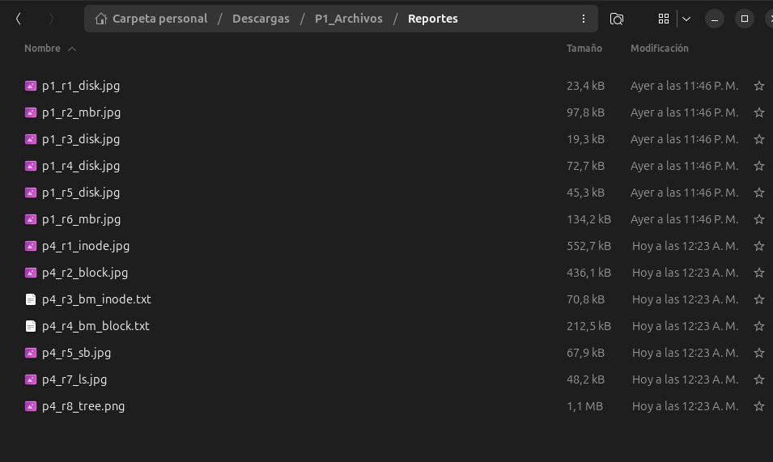

---

### 7. Interfaz de Iniciar Sesión

**Descripción:**

Una vez que has creado un disco, particionado el espacio y formateado una partición con EXT2, podrás acceder a una interfaz gráfica dedicada para iniciar sesión. Esta interfaz reemplaza el comando `login` en línea de comandos, proporcionando una experiencia más intuitiva y amigable.

**Funcionalidad:**

- **Selector de Partición:** Despliega todas las particiones montadas disponibles para que selecciones la que deseas utilizar.
- **Campo de Usuario:** Ingresa el nombre del usuario (por defecto: **root**).
- **Campo de Contraseña:** Ingresa la contraseña del usuario (usuario root por defecto tiene contraseña **123**).
- **Botón Ingresar:** Ejecuta el login de forma segura.

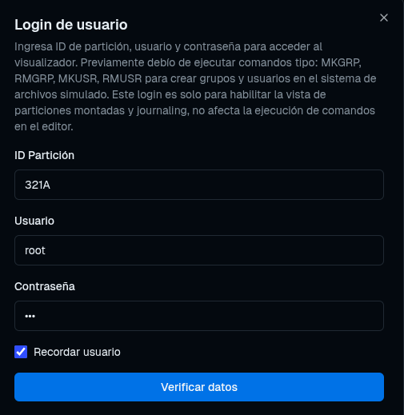

**Comandos que Requieren Sesión Previa:**

Los siguientes comandos solo funcionan después de haber iniciado sesión:

- **mkgrp** – Crear grupos de usuarios
- **rmgrp** – Eliminar grupos
- **mkusr** – Crear usuarios nuevos
- **rmusr** – Eliminar usuarios
- **mkfile** – Crear archivos
- **mkdir** – Crear carpetas
- **cat** – Visualizar contenido de archivos
- **chmod** – Cambiar permisos
- **chown** – Cambiar propietario
- **remove** – Eliminar archivos/carpetas
- **rename** – Renombrar elementos
- **copy** – Copiar archivos/carpetas
- **move** – Mover archivos/carpetas
- **find** – Buscar archivos

**Botón de Cerrar Sesión:**

Una vez logueado, aparecerá un botón **"Cerrar Sesión"** en la barra superior de la interfaz principal. Al hacer clic, se termina la sesión actual y devuelve a la pantalla de inicio.


---

### 8. Visualizador del Sistema de Archivos

**Descripción:**

El Visualizador del Sistema de Archivos es una interfaz gráfica que te permite explorar la estructura del disco de manera visual, similar a un explorador de archivos tradicional. Una vez logueado, podrás navegar por todos los discos, particiones, carpetas y archivos del sistema simulado.

**Características:**

- Navegación visual e intuitiva
- Visualización jerárquica de directorios
- Visualización de contenido de archivos
- Información detallada de permisos y propiedades
- Modo solo lectura (no permite modificar desde la interfaz, solo mediante comandos)

#### 8.1 Selección de Disco

Al acceder al visualizador, aparecerá una pantalla que lista todos los discos creados en tu sistema.

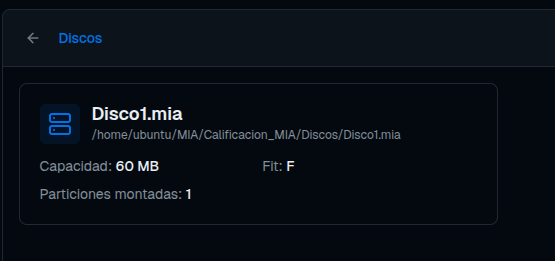

**Información mostrada por disco:**

- **Nombre/Identificador:** Nombre del archivo .mia
- **Capacidad Total:** Tamaño del disco en MB/GB
- **Tipo de Ajuste (Fit):** BF (Best Fit), FF (First Fit) o WF (Worst Fit)
- **Particiones Montadas:** Número de particiones activas

Selecciona cualquier disco haciendo clic sobre él para pasar a la vista de selección de particiones.

#### 8.2 Selección de Partición

Después de seleccionar un disco, se mostrarán todas sus particiones disponibles.

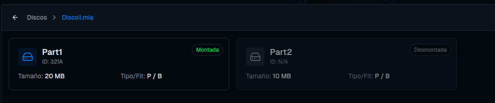

**Información mostrada por partición:**

- **Nombre de Partición:** Identificador asignado (ej. Part1, Part2)
- **Tamaño:** Capacidad de la partición
- **Tipo:** Primaria (P), Extendida (E) o Lógica (L)
- **Tipo de Ajuste (Fit):** Algoritmo de asignación utilizado
- **Estado:** Montada ✅ / No montada ❌

Selecciona la partición que deseas explorar para ver su estructura de archivos.

#### 8.3 Navegación del Sistema de Archivos

Una vez seleccionada una partición, entrarás al explorador de archivos comenzando desde la carpeta raíz `/`.

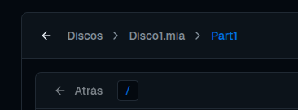

**Elementos Mostrados:**

- **Carpetas:** Puedes hacer clic en cualquier carpeta para navegar hacia su interior.
- **Archivos:** Se muestran con su ícono correspondiente (documento, imagen, etc).
- **Ruta Actual:** Barra superior mostrando dónde te encuentras (ej. / > home > user > docs).
- **Propiedades:** Cada elemento muestra:
  - Nombre
  - Tipo (Archivo o Carpeta)
  - Tamaño en bytes
  - Propietario (UID)
  - Grupo (GID)
  - Permisos (formato UGO: Usuario, Grupo, Otros)
  - Fechas de creación, modificación y acceso

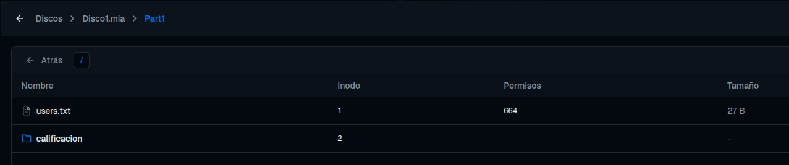

**Cómo Navegar:**

1. Haz doble clic en una carpeta para entrar en ella.
2. Usa el botón **"Atrás"** o la ruta superior para subir de nivel.
3. Haz clic en un archivo para seleccionarlo y ver sus detalles.

#### 8.4 Visualización de Archivos

Al seleccionar un archivo de texto, se abre un panel de visualización mostrando su contenido completo.

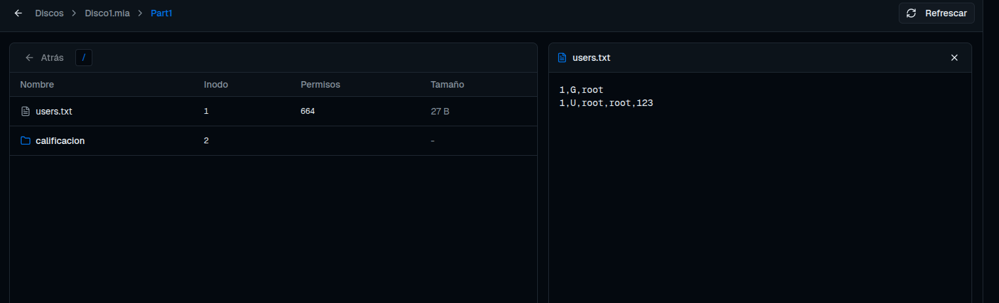

**Características:**

- Muestra el contenido del archivo en formato texto
- Información de propiedades y permisos del archivo
- Botón **"Descargar"** para guardar el archivo en tu computadora
- Botón **"Volver"** para regresar al explorador

#### 8.5 Visualización de Journaling

**Descripción:**

El Visualizador de Journaling permite consultar el registro de transacciones de una partición formateada con el sistema de archivos EXT3. Esta herramienta es fundamental para entender qué operaciones se han realizado en el sistema, asegurando la integridad de los datos.

**Características:**

- **Tabla Detallada:** Muestra una lista estructurada con todas las operaciones ejecutadas en la partición.
- **Información por Transacción:**
  - **Operación:** Tipo de comando ejecutado (ej. `mkdir`, `mkfile`, `remove`).
  - **Ruta:** Ubicación en el sistema de archivos donde se realizó la operación.
  - **Contenido/Datos:** Texto o parámetros asociados a la creación del archivo (si aplica).
  - **Fecha:** Marca de tiempo exacta en que ocurrió la operación.
- **Lectura Automática:** Los datos se obtienen directamente de los bloques de journaling de la partición EXT3 seleccionada.

Para acceder a este registro, selecciona una partición EXT3 y busca el botón de **"Journaling"** en la interfaz.

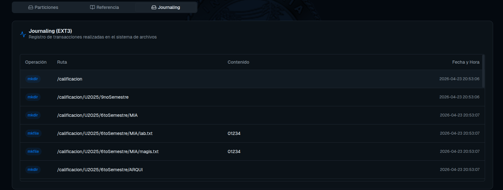

---

### 9. Gestión de Particiones Montadas y Reportes

- Después de `mount` y `mkfs`, ve a la pestaña **Particiones** para verificar.
- Cada reporte generado aparece en la sección inferior con vista previa y botón de descarga.
- Usa el comando `tree` para ver la estructura completa de carpetas/archivos.

---

### 10. Consejos y Buenas Prácticas

- Siempre inicia sesión como **root** al principio.
- Usa `-p` y `-r` para evitar errores de carpetas inexistentes.
- Guarda tus scripts .mia para repetir pruebas fácilmente.
- Genera reportes después de cada operación importante (mbr, disk, tree).
- Si un comando falla, revisa la Consola de Salida: muestra el error exacto.
- No cambies el tamaño de un disco después de crearlo.

---

### 11. Solución de Problemas Comunes

| Problema                 | Causa posible       | Solución                              |
| ------------------------ | ------------------- | ------------------------------------- |
| “No existe la partición” | No se montó         | Ejecuta `mount` primero               |
| Error de permisos        | No estás logueado   | `login -user=root -pass=123 -id=XXXX` |
| Disco no se crea         | Ruta con espacios   | Usa comillas dobles                   |
| Reporte vacío            | No formateaste      | Ejecuta `mkfs` primero                |
| Consola no responde      | Backend no iniciado | Reinicia el servidor C++              |

---

### 12. Referencias y Ayuda Adicional

- Pestaña **Referencia** dentro de la aplicación (lista rápida).
- Enunciado oficial del proyecto (PDF).
- Carpeta `reports/` donde se guardan todos los .jpg/.txt generados.
